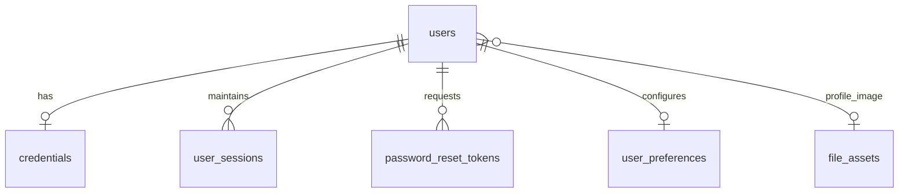
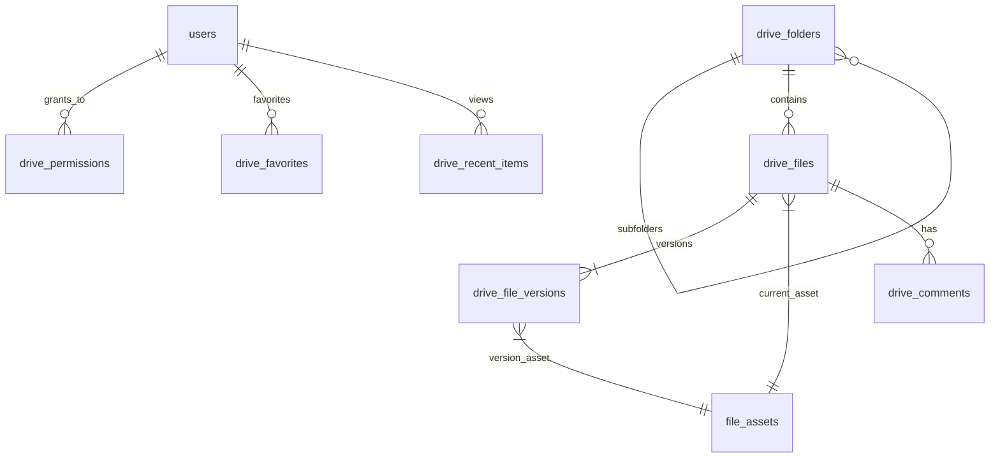
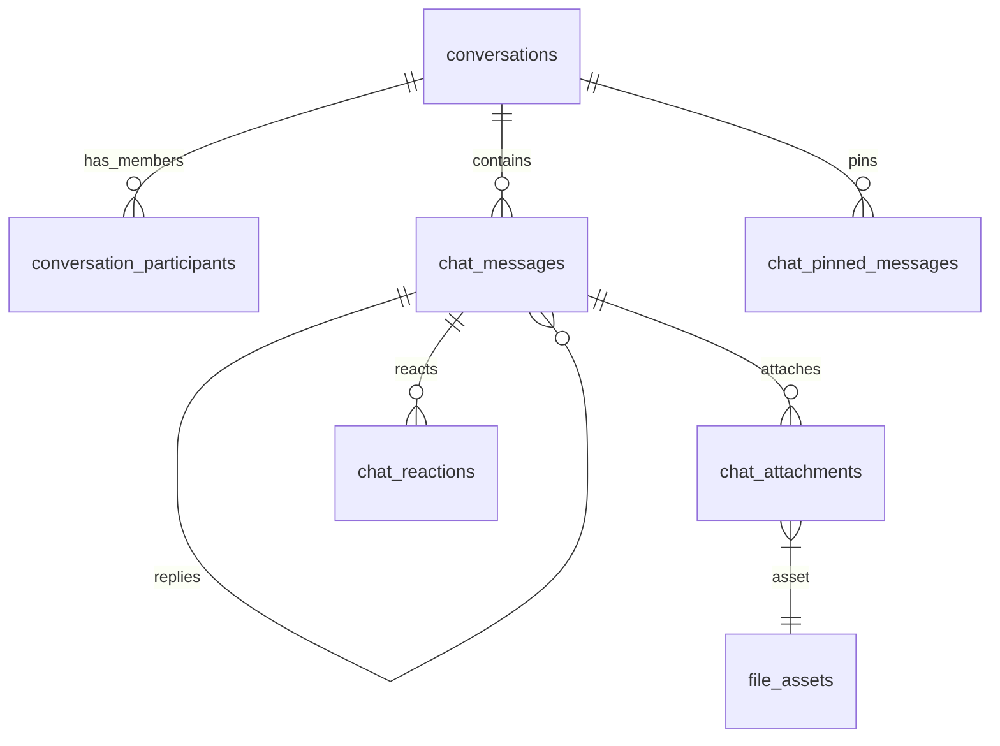
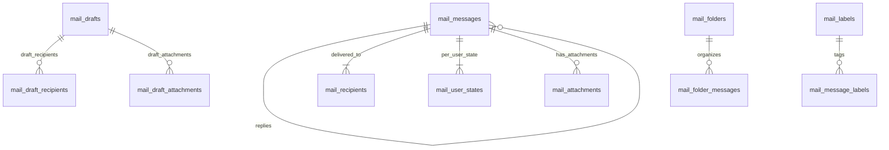
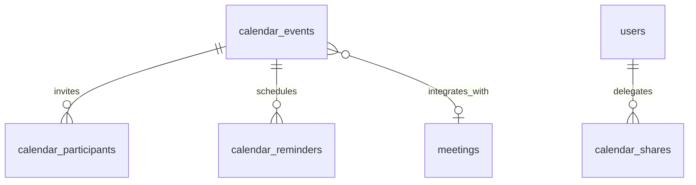

# Orvexa Platform — Database Design Specification

## Document Control & Metadata

| Attribute | Specification |
| :--- | :--- |
| **Document Title** | Orvexa Enterprise Database Design Specification |
| **Document Version** | `1.0.0` (Production Reference) |
| **Status** | Approved / Living Technical Architecture Document |
| **Target Database Engine** | PostgreSQL 16+ (Relational with JSONB, Partial Indexes & Check Constraints) |
| **Data Access Layer / ORM** | Prisma ORM 5+ (Multi-File Schema Feature: `apps/api/prisma/schema/*.prisma`) |
| **Primary Key Architecture** | 64-bit BigInt (`BIGSERIAL` / `int8`) across all core entities |
| **Timestamp Standard** | `TIMESTAMPTZ(6)` (Microsecond-precision UTC timestamps) |
| **Last Reviewed** | November 2026 |

---

## 1. Executive Summary & Architecture Principles

### 1.1 Platform Context
**Orvexa** is an enterprise-grade unified digital workspace and communication suite combining real-time team collaboration, email management, cloud drive document storage, calendar scheduling, WebRTC video conferencing (via LiveKit), media asset management (via Cloudinary), and auditable activity tracking into a cohesive platform.

The underlying relational database is designed to handle high transaction volumes, provide strong referential integrity, maintain zero orphaned entities, and support low-latency real-time queries for web and mobile clients.

### 1.2 Core Architectural Principles

1. **Third Normal Form (3NF) Baseline with Targeted Denormalization**  
   All entity models are normalized to 3NF to eliminate update anomalies. Selective denormalization (such as `last_message_at` on conversations or `current_version` on drive files) is applied exclusively where query profiling demonstrates high read concurrency requirements.

2. **64-bit Integer (`BigInt`) Identifiers Everywhere**  
   To prevent 32-bit integer overflow failures in high-volume collaboration apps (e.g., millions of chat messages, notifications, and mail logs), all surrogate primary keys and foreign key references utilize PostgreSQL `BigInt` (`BIGSERIAL`). The TypeScript application layer serializes `BigInt` values to string format in JSON responses (`BigInt.prototype.toJSON = function() { return this.toString(); }`), preventing IEEE 754 precision loss in JavaScript runtimes.

3. **Timezone Awareness & Temporal Consistency**  
   All temporal fields utilize `TIMESTAMPTZ(6)` (PostgreSQL `timestamp with time zone` with microsecond precision). Application services persist exclusively in UTC; client applications format timestamps according to the user's localized timezone configured in `user_preferences.timezone`.

4. **Decoupled Physical Storage & Digital Asset Management (DAM)**  
   No binary data or base64 blobs are stored inside PostgreSQL. All binary media (attachments, avatars, recordings, drive files) are registered in a central `file_assets` table that abstracts Cloudinary storage, asset metadata (width, height, duration, delivery type, MIME type), and cloud deletion lifecycles. Domain models link to `file_assets` via foreign keys.

5. **Exclusion of Fragile Generic Polymorphic Foreign Keys**  
   Rather than using anti-pattern polymorphic columns (`entity_type` + `entity_id` without database constraints), shared relationships (such as Drive permissions, favorites, and recent items) use **Exclusive Arc / XOR Foreign Keys** backed by PostgreSQL `CHECK` constraints and partial unique indexes. This guarantees 100% database-enforced referential integrity.

6. **Mathematical Guarantees via Database Invariants**  
   Critical business rules (such as ensuring only one 1-on-1 direct conversation can ever exist between two users, and ensuring calendar event start times precede end times) are enforced at the database layer via PostgreSQL `CHECK` constraints, functional indexes, and partial unique indexes.

---

## 2. Technical Specifications & Standards

### 2.1 Database & Driver Specifications
- **RDBMS Engine:** PostgreSQL 16.x or newer
- **Character Encoding:** `UTF-8`
- **Collation:** `en_US.UTF-8`
- **Connection Pooling:** Prisma Client pooled connections via connection manager (PgBouncer compatible)
- **Time Zone:** UTC (`+00:00`)

### 2.2 Naming Conventions
- **Database Tables:** Pluralized `snake_case` (e.g., `users`, `chat_messages`, `drive_files`).
- **Database Columns:** `snake_case` (e.g., `user_id`, `created_at`, `refresh_token_hash`).
- **Primary Keys:** Standardized as `id` (`BigInt`, autoincrementing identity).
- **Foreign Keys:** Single reference named `<entity>_id` (e.g., `user_id`, `conversation_id`). Role-specific references named `<role>_<entity>_id` or `<role>_id` (e.g., `direct_user_low_id`, `direct_user_high_id`, `host_id`, `actor_id`).
- **Prisma Schema Models:** Singular `PascalCase` mapped via `@@map("table_name")` (e.g., `ChatMessage` mapped to `chat_messages`).
- **Prisma Fields:** `camelCase` mapped via `@map("column_name")` (e.g., `refreshTokenHash` mapped to `refresh_token_hash`).
- **Indexes:** `<table_name>_<columns>_idx` for standard indexes; `<table_name>_<columns>_key` or `<table_name>_<columns>_uidx` for unique indexes.

### 2.3 Modular Multi-File Schema Organization
The database schema is managed via Prisma's `prismaSchemaFolder` preview feature located at `apps/api/prisma/schema/`:
- `schema.prisma` — Client generator and PostgreSQL datasource configuration.
- `enums.prisma` — Centralized enumerated types across all platform domains.
- `auth.prisma` — Identity, internal mail handle, communication email, credentials, sessions, tokens, and preferences.
- `storage.prisma` — Cloudinary-backed digital asset storage registry.
- `drive.prisma` — Document management, folders, versions, permissions, comments.
- `chat.prisma` — Direct messages, channels, threads, reactions, pins.
- `mail.prisma` — Email threads, recipients, per-user state, drafts, folders, labels.
- `calendar.prisma` — Events, RSVP participants, reminders, calendar shares.
- `meeting.prisma` — WebRTC LiveKit meetings, roles, attendance, recordings.
- `notification.prisma` — Centralized user notification inbox.
- `audit.prisma` — Security and administrative compliance audit trail.

---

## 3. High-Level Subsystem Architecture

The Orvexa database is segmented into 10 cohesive business domains revolving around two foundational anchors: **`users`** and **`file_assets`**.

```mermaid
flowchart TD
    %% Base Infrastructure
    U[users]:::core
    FA[file_assets]:::core
    
    %% Auth Subsystem
    subgraph SUB_AUTH [Identity & Access Management]
        U --- CRED[credentials]
        U --- SESS[user_sessions]
        U --- TOK[password_reset_tokens]
        U --- PREF[user_preferences]
    end

    %% Drive Subsystem
    subgraph SUB_DRIVE [Cloud Drive DMS]
        U --- DF[drive_folders]
        DF --- DFL[drive_files]
        DFL --- DFV[drive_file_versions]
        DFL --- DCOM[drive_comments]
        U --- DPERM[drive_permissions]
        U --- DFAV[drive_favorites]
        U --- DREC[drive_recent_items]
        DFL --> FA
        DFV --> FA
    end

    %% Chat Subsystem
    subgraph SUB_CHAT [Chat & Channels]
        U --- CONV[conversations]
        CONV --- CPART[conversation_participants]
        CONV --- CMSG[chat_messages]
        CMSG --- CATT[chat_attachments]
        CMSG --- CREAC[chat_reactions]
        CMSG --- CPIN[chat_pinned_messages]
        CATT --> FA
        CONV -.-> FA
    end

    %% Mail Subsystem
    subgraph SUB_MAIL [Unified Mail]
        U --- MMSG[mail_messages]
        MMSG --- MREC[mail_recipients]
        MMSG --- MSTA[mail_user_states]
        MMSG --- MATT[mail_attachments]
        U --- MDRAFT[mail_drafts]
        MDRAFT --- MDREC[mail_draft_recipients]
        MDRAFT --- MDATT[mail_draft_attachments]
        U --- MFOLD[mail_folders]
        MFOLD --- MFM[mail_folder_messages]
        U --- MLBL[mail_labels]
        MLBL --- MML[mail_message_labels]
        MATT --> FA
        MDATT --> FA
    end

    %% Calendar & Meetings
    subgraph SUB_CAL [Calendar & Meetings]
        U --- CEVT[calendar_events]
        CEVT --- CP[calendar_participants]
        CEVT --- CREM[calendar_reminders]
        U --- CSH[calendar_shares]
        U --- MEET[meetings]
        MEET --- MP[meeting_participants]
        MEET --- MREC_REC[meeting_recordings]
        CEVT -.-> MEET
        MEET -.-> CONV
        MREC_REC --> FA
    end

    %% Audit & Notifications
    subgraph SUB_OBS [Audit & Notification]
        U --- NOTIF[notifications]
        U --- AUD[audit_logs]
    end

    %% Base Asset Links
    U -. Profile Image .-> FA
    ORG -. Org Logo .-> FA

    classDef core fill:#1e293b,stroke:#38bdf8,stroke-width:2px,color:#fff;
```



---

## 4. Enumerated Types (Enums) Reference

The database defines 16 PostgreSQL native enum types ensuring strict type safety and domain validation:

| Enum Name | Allowed Values | Subsystem | Purpose & Semantics |
| :--- | :--- | :--- | :--- |
| `UserRole` | `ADMIN`, `MEMBER` | IAM | System-wide administrative authorization level. |
| `CloudinaryResourceType` | `IMAGE`, `VIDEO`, `RAW` | Storage | Classifies uploaded asset types in Cloudinary. |
| `CloudinaryDeliveryType` | `UPLOAD`, `AUTHENTICATED`, `PRIVATE` | Storage | Access control for generated Cloudinary delivery URLs. |
| `MailRecipientType` | `TO`, `CC`, `BCC` | Mail | Standard RFC 5322 recipient delivery channels. |
| `ConversationType` | `DIRECT`, `GROUP`, `CHANNEL` | Chat | 1-on-1 direct messaging, group chat, or broadcast channel. |
| `ChannelVisibility` | `PUBLIC`, `PRIVATE` | Chat | Channel discoverability and membership authorization. |
| `ConversationMemberRole` | `OWNER`, `ADMIN`, `MEMBER` | Chat | Channel/group administrative and moderation privileges. |
| `ChatMessageType` | `TEXT`, `IMAGE`, `FILE`, `AUDIO`, `SYSTEM` | Chat | Defines payload rendering and parser handling. |
| `DriveAccessLevel` | `VIEWER`, `EDITOR`, `MANAGER` | Drive | Read, read-write, or administrative control over drive nodes. |
| `CalendarEventType` | `PERSONAL`, `SHARED` | Calendar | Distinguishes private user items from collaborated meetings. |
| `EventVisibility` | `PRIVATE`, `PUBLIC` | Calendar | Calendar attendee and free/busy visibility flags. |
| `CalendarAccessLevel` | `VIEWER`, `EDITOR` | Calendar | Access permission granted when sharing an entire calendar. |
| `InvitationStatus` | `PENDING`, `ACCEPTED`, `DECLINED`, `TENTATIVE` | Cal / Meeting | Standard RSVP state machine for events and meetings. |
| `MeetingStatus` | `SCHEDULED`, `LIVE`, `ENDED`, `CANCELLED` | Meetings | Lifecycle phase of a WebRTC conferencing session. |
| `MeetingRole` | `HOST`, `CO_HOST`, `PARTICIPANT` | Meetings | Audio/video moderation and breakout room privileges. |
| `NotificationType` | `MAIL`, `CHAT`, `CALENDAR`, `MEETING`, `DRIVE`, `SYSTEM` | Notifications | Category router for notifications and client push dispatch. |

---

## 5. Subsystem Data Dictionary & Detailed Entity Design

### 5.1 Identity & Access Management (IAM) Domain



#### 5.2.1 `users`
Core user entity representing organization employees, administrators, and members.

| Column | PostgreSQL Type | Prisma Type | Constraints & Defaults | Description |
| :--- | :--- | :--- | :--- | :--- |
| `id` | `BIGINT` | `BigInt` | `PK`, `autoincrement()` | Unique user identifier. |
| `full_name` | `VARCHAR(150)` | `String` | `NOT NULL` | User legal or display name. |
| `username` | `VARCHAR(100)` | `String` | `NOT NULL`, `UNIQUE` | Internal mail handle (`<username>@orvexa.com`) and system login identifier. |
| `profile_image_id` | `BIGINT` | `BigInt?` | `FK -> file_assets(id)`, `ON DELETE SET NULL` | Reference to uploaded avatar image asset. |
| `email` | `VARCHAR(255)` | `String` | `NOT NULL`, `UNIQUE` | External communication & recovery email for password reset and notifications. |
| `phone` | `VARCHAR(20)` | `String?` | `NULL` | E.164 formatted international telephone number. |
| `dob` | `DATE` | `DateTime?` | `NULL` | Date of birth for compliance and directory profiling. |
| `gender` | `VARCHAR(30)` | `String?` | `NULL` | Optional demographic identifier. |
| `address` | `TEXT` | `String?` | `NULL` | Physical address information. |
| `role` | `UserRole` | `UserRole` | `NOT NULL`, `DEFAULT MEMBER` | System authorization level (`ADMIN` or `MEMBER`). |
| `is_active` | `BOOLEAN` | `Boolean` | `NOT NULL`, `DEFAULT true` | Account active status (disabling prevents all logins). |
| `last_login_at` | `TIMESTAMPTZ(6)` | `DateTime?` | `NULL` | Timestamp of latest authenticated session creation. |
| `created_at` | `TIMESTAMPTZ(6)` | `DateTime` | `NOT NULL`, `DEFAULT now()` | User onboarding timestamp. |
| `updated_at` | `TIMESTAMPTZ(6)` | `DateTime` | `NOT NULL`, `@updatedAt` | Last profile modification timestamp. |

**Indexes & Invariants:**
- `users_username_key`: `UNIQUE ("username")` — Enforces unique internal mail handle / username across the workspace.
- `users_email_key`: `UNIQUE ("email")` — Enforces unique communication email accounts across the workspace.

---

#### 5.2.2 `credentials`
Stores sensitive authentication secrets separated from the public `users` table to mitigate data exposure during broad table scans.

| Column | PostgreSQL Type | Prisma Type | Constraints & Defaults | Description |
| :--- | :--- | :--- | :--- | :--- |
| `id` | `BIGINT` | `BigInt` | `PK`, `autoincrement()` | Identifier. |
| `user_id` | `BIGINT` | `BigInt` | `NOT NULL`, `UNIQUE`, `FK -> users(id)`, `ON DELETE CASCADE` | 1-to-1 link to user account. |
| `password_hash` | `VARCHAR(255)` | `String` | `NOT NULL` | Cryptographically salted hash (Argon2id or bcrypt). |
| `password_changed_at` | `TIMESTAMPTZ(6)` | `DateTime?` | `NULL` | Timestamp of last password change (invalidates old tokens). |
| `failed_login_attempts` | `INTEGER` | `Int` | `NOT NULL`, `DEFAULT 0` | Consecutive failed authentication counter. |
| `locked_until` | `TIMESTAMPTZ(6)` | `DateTime?` | `NULL` | Account lockout expiration timestamp. |
| `created_at` | `TIMESTAMPTZ(6)` | `DateTime` | `NOT NULL`, `DEFAULT now()` | Record creation timestamp. |
| `updated_at` | `TIMESTAMPTZ(6)` | `DateTime` | `NOT NULL`, `@updatedAt` | Record update timestamp. |

---

#### 5.2.3 `user_sessions`
Tracks active client sessions and persistent refresh tokens for token rotation.

| Column | PostgreSQL Type | Prisma Type | Constraints & Defaults | Description |
| :--- | :--- | :--- | :--- | :--- |
| `id` | `BIGINT` | `BigInt` | `PK`, `autoincrement()` | Session identifier. |
| `user_id` | `BIGINT` | `BigInt` | `NOT NULL`, `FK -> users(id)`, `ON DELETE CASCADE` | Owner user ID. |
| `refresh_token_hash` | `VARCHAR(255)` | `String` | `NOT NULL` | SHA-256 hash of the issued refresh token secret. |
| `device_name` | `VARCHAR(255)` | `String?` | `NULL` | Friendly device name (e.g., "MacBook Pro - Chrome"). |
| `user_agent` | `TEXT` | `String?` | `NULL` | Raw client browser/mobile HTTP User-Agent string. |
| `ip_address` | `VARCHAR(45)` | `String?` | `NULL` | Client IPv4 or IPv6 address. |
| `last_used_at` | `TIMESTAMPTZ(6)` | `DateTime?` | `NULL` | Timestamp of last session activity. |
| `expires_at` | `TIMESTAMPTZ(6)` | `DateTime` | `NOT NULL` | Hard expiration timestamp for this session. |
| `revoked_at` | `TIMESTAMPTZ(6)` | `DateTime?` | `NULL` | Explicit logout/revocation timestamp. |
| `created_at` | `TIMESTAMPTZ(6)` | `DateTime` | `NOT NULL`, `DEFAULT now()` | Session inception timestamp. |

**Indexes & Invariants:**
- `user_sessions_refresh_token_hash_idx`: Index on `("refresh_token_hash")` for sub-millisecond token lookups.
- `user_sessions_user_id_expires_at_idx`: Compound index on `("user_id", "expires_at")` for active user session listing and sweep queries.

---

#### 5.2.4 `password_reset_tokens`
Ephemeral tokens for secure self-service password recovery.

| Column | PostgreSQL Type | Prisma Type | Constraints & Defaults | Description |
| :--- | :--- | :--- | :--- | :--- |
| `id` | `BIGINT` | `BigInt` | `PK`, `autoincrement()` | Identifier. |
| `user_id` | `BIGINT` | `BigInt` | `NOT NULL`, `FK -> users(id)`, `ON DELETE CASCADE` | Target user ID. |
| `token_hash` | `VARCHAR(255)` | `String` | `NOT NULL`, `UNIQUE` | SHA-256 hash of the one-time reset token. |
| `expires_at` | `TIMESTAMPTZ(6)` | `DateTime` | `NOT NULL` | Token expiration timestamp (e.g., 15-30 minutes). |
| `used_at` | `TIMESTAMPTZ(6)` | `DateTime?` | `NULL` | Timestamp when the token was successfully redeemed. |
| `created_at` | `TIMESTAMPTZ(6)` | `DateTime` | `NOT NULL`, `DEFAULT now()` | Dispatch timestamp. |

**Indexes & Invariants:**
- `password_reset_tokens_token_hash_key`: `UNIQUE ("token_hash")`.
- `password_reset_tokens_user_id_idx`: Index on `("user_id")` to revoke previous pending tokens upon new requests.

---

#### 5.2.5 `user_preferences`
User-level UI preferences and notification channel configurations.

| Column | PostgreSQL Type | Prisma Type | Constraints & Defaults | Description |
| :--- | :--- | :--- | :--- | :--- |
| `id` | `BIGINT` | `BigInt` | `PK`, `autoincrement()` | Identifier. |
| `user_id` | `BIGINT` | `BigInt` | `NOT NULL`, `UNIQUE`, `FK -> users(id)`, `ON DELETE CASCADE` | 1-to-1 link to user account. |
| `theme` | `VARCHAR(20)` | `String` | `NOT NULL`, `DEFAULT 'system'` | UI theme (`light`, `dark`, `system`). |
| `language` | `VARCHAR(20)` | `String` | `NOT NULL`, `DEFAULT 'en'` | ISO 639-1 language code. |
| `timezone` | `VARCHAR(100)` | `String` | `NOT NULL`, `DEFAULT 'UTC'` | User-specific IANA timezone override. |
| `notification_preferences` | `JSONB` | `Json?` | `NULL` | Structured notification flags (email, push, desktop, sound). |
| `created_at` | `TIMESTAMPTZ(6)` | `DateTime` | `NOT NULL`, `DEFAULT now()` | Inception timestamp. |
| `updated_at` | `TIMESTAMPTZ(6)` | `DateTime` | `NOT NULL`, `@updatedAt` | Last modification timestamp. |

---

### 5.3 Media Storage & Digital Asset Management (DAM) Domain

#### 5.3.1 `file_assets`
Central repository for all multimedia assets and binary files hosted via Cloudinary.

| Column | PostgreSQL Type | Prisma Type | Constraints & Defaults | Description |
| :--- | :--- | :--- | :--- | :--- |
| `id` | `BIGINT` | `BigInt` | `PK`, `autoincrement()` | Asset surrogate identifier. |
| `cloudinary_asset_id` | `VARCHAR(64)` | `String?` | `UNIQUE`, `NULL` | Internal Cloudinary hexadecimal asset ID. |
| `public_id` | `VARCHAR(500)` | `String` | `NOT NULL` | Cloudinary public ID / file path slug. |
| `resource_type` | `CloudinaryResourceType` | `CloudinaryResourceType` | `NOT NULL` | Media kind (`IMAGE`, `VIDEO`, `RAW`). |
| `delivery_type` | `CloudinaryDeliveryType` | `CloudinaryDeliveryType` | `NOT NULL`, `DEFAULT AUTHENTICATED` | URL protection level (`UPLOAD`, `AUTHENTICATED`, `PRIVATE`). |
| `version` | `INTEGER` | `Int?` | `NULL` | Cloudinary cache-busting version sequence. |
| `format` | `VARCHAR(20)` | `String?` | `NULL` | File extension / format (e.g., `png`, `pdf`, `mp4`). |
| `original_filename` | `VARCHAR(255)` | `String` | `NOT NULL` | Client-provided original file upload name. |
| `mime_type` | `VARCHAR(150)` | `String` | `NOT NULL` | Standard IANA media type (e.g., `application/pdf`). |
| `bytes` | `BIGINT` | `BigInt` | `NOT NULL` | Exact payload size in bytes. |
| `secure_url` | `TEXT` | `String?` | `NULL` | HTTPS CDN delivery URL. |
| `width` | `INTEGER` | `Int?` | `NULL` | Pixel width (for images and videos). |
| `height` | `INTEGER` | `Int?` | `NULL` | Pixel height (for images and videos). |
| `duration_seconds` | `DOUBLE PRECISION` | `Float?` | `NULL` | Playback duration in seconds (for audio/video/recordings). |
| `uploaded_by` | `BIGINT` | `BigInt?` | `FK -> users(id)`, `ON DELETE SET NULL` | User who uploaded the physical asset. |
| `cloud_deleted_at` | `TIMESTAMPTZ(6)` | `DateTime?` | `NULL` | Timestamp when marked for or purged from cloud storage. |
| `created_at` | `TIMESTAMPTZ(6)` | `DateTime` | `NOT NULL`, `DEFAULT now()` | Ingestion timestamp. |

**Indexes & Invariants:**
- `file_assets_resource_type_delivery_type_public_id_key`: `UNIQUE ("resource_type", "delivery_type", "public_id")` — Ensures absolute uniqueness for physical cloud resources.
- `file_assets_uploaded_by_idx`: Index on `("uploaded_by")` for quota and usage aggregation.
- `file_assets_cloud_deleted_at_created_at_idx`: Index on `("cloud_deleted_at", "created_at")` powering garbage collection cleanup workers.

---

### 5.4 Cloud Drive & Document Management Subsystem (DMS)



#### 5.4.1 `drive_folders`
Hierarchical tree storage nodes representing virtual directories.

| Column | PostgreSQL Type | Prisma Type | Constraints & Defaults | Description |
| :--- | :--- | :--- | :--- | :--- |
| `id` | `BIGINT` | `BigInt` | `PK`, `autoincrement()` | Folder identifier. |
| `name` | `VARCHAR(255)` | `String` | `NOT NULL` | Folder directory name. |
| `owner_id` | `BIGINT` | `BigInt` | `NOT NULL`, `FK -> users(id)`, `ON DELETE RESTRICT` | Folder creator/owner. |
| `parent_folder_id` | `BIGINT` | `BigInt?` | `FK -> drive_folders(id)`, `ON DELETE RESTRICT` | Self-referencing parent directory (`NULL` = root). |
| `created_at` | `TIMESTAMPTZ(6)` | `DateTime` | `NOT NULL`, `DEFAULT now()` | Directory creation timestamp. |
| `updated_at` | `TIMESTAMPTZ(6)` | `DateTime` | `NOT NULL`, `@updatedAt` | Directory modification timestamp. |
| `deleted_at` | `TIMESTAMPTZ(6)` | `DateTime?` | `NULL` | Soft deletion timestamp (trash can state). |
| `deleted_by` | `BIGINT` | `BigInt?` | `FK -> users(id)`, `ON DELETE SET NULL` | User who soft-deleted the directory. |

**Indexes & Invariants:**
- `drive_folders_owner_id_parent_folder_id_idx`: Compound index on `("owner_id", "parent_folder_id")` providing instant directory listing without table scans.

---

#### 5.4.2 `drive_files`
Represents a document or file entity in the drive. Tracks the active/current asset pointer and version sequence.

| Column | PostgreSQL Type | Prisma Type | Constraints & Defaults | Description |
| :--- | :--- | :--- | :--- | :--- |
| `id` | `BIGINT` | `BigInt` | `PK`, `autoincrement()` | File identifier. |
| `name` | `VARCHAR(255)` | `String` | `NOT NULL` | Display filename in drive. |
| `owner_id` | `BIGINT` | `BigInt` | `NOT NULL`, `FK -> users(id)`, `ON DELETE RESTRICT` | File owner. |
| `folder_id` | `BIGINT` | `BigInt?` | `FK -> drive_folders(id)`, `ON DELETE RESTRICT` | Parent folder (`NULL` = root drive). |
| `asset_id` | `BIGINT` | `BigInt` | `NOT NULL`, `FK -> file_assets(id)`, `ON DELETE RESTRICT` | Head pointer to active `file_assets` record. |
| `current_version` | `INTEGER` | `Int` | `NOT NULL`, `DEFAULT 1` | Active version number sequence. |
| `created_at` | `TIMESTAMPTZ(6)` | `DateTime` | `NOT NULL`, `DEFAULT now()` | Creation timestamp. |
| `updated_at` | `TIMESTAMPTZ(6)` | `DateTime` | `NOT NULL`, `@updatedAt` | Modification timestamp. |
| `deleted_at` | `TIMESTAMPTZ(6)` | `DateTime?` | `NULL` | Soft deletion timestamp. |
| `deleted_by` | `BIGINT` | `BigInt?` | `FK -> users(id)`, `ON DELETE SET NULL` | User who soft-deleted the file. |

**Indexes & Invariants:**
- `drive_files_owner_id_folder_id_idx`: Compound index on `("owner_id", "folder_id")` for tree listing.
- `drive_files_asset_id_idx`: Index on `("asset_id")` to track storage references.

---

#### 5.4.3 `drive_file_versions`
Immutable audit log of historical versions uploaded for each file.

| Column | PostgreSQL Type | Prisma Type | Constraints & Defaults | Description |
| :--- | :--- | :--- | :--- | :--- |
| `id` | `BIGINT` | `BigInt` | `PK`, `autoincrement()` | Version identifier. |
| `file_id` | `BIGINT` | `BigInt` | `NOT NULL`, `FK -> drive_files(id)`, `ON DELETE CASCADE` | Owning drive file. |
| `version_number` | `INTEGER` | `Int` | `NOT NULL` | Monotonically increasing revision number (1, 2, ...). |
| `asset_id` | `BIGINT` | `BigInt` | `NOT NULL`, `FK -> file_assets(id)`, `ON DELETE RESTRICT` | Physical binary asset for this specific revision. |
| `uploaded_by` | `BIGINT` | `BigInt` | `NOT NULL`, `FK -> users(id)`, `ON DELETE RESTRICT` | Contributor who uploaded this revision. |
| `created_at` | `TIMESTAMPTZ(6)` | `DateTime` | `NOT NULL`, `DEFAULT now()` | Upload timestamp. |

**Indexes & Invariants:**
- `drive_file_versions_file_id_version_number_key`: `UNIQUE ("file_id", "version_number")` — Guarantees continuous revision sequence without duplicates.
- `drive_file_versions_asset_id_idx`: Index on `("asset_id")`.

---

#### 5.4.4 `drive_permissions`
Granular Role-Based Access Control (RBAC) sharing permissions applied directly to files or folders.

| Column | PostgreSQL Type | Prisma Type | Constraints & Defaults | Description |
| :--- | :--- | :--- | :--- | :--- |
| `id` | `BIGINT` | `BigInt` | `PK`, `autoincrement()` | Permission identifier. |
| `file_id` | `BIGINT` | `BigInt?` | `FK -> drive_files(id)`, `ON DELETE CASCADE` | Target file (exclusive with `folder_id`). |
| `folder_id` | `BIGINT` | `BigInt?` | `FK -> drive_folders(id)`, `ON DELETE CASCADE` | Target folder (exclusive with `file_id`). |
| `user_id` | `BIGINT` | `BigInt` | `NOT NULL`, `FK -> users(id)`, `ON DELETE CASCADE` | Granted user recipient. |
| `access_level` | `DriveAccessLevel` | `DriveAccessLevel` | `NOT NULL` | Authorization scope (`VIEWER`, `EDITOR`, `MANAGER`). |
| `granted_by` | `BIGINT` | `BigInt` | `NOT NULL`, `FK -> users(id)`, `ON DELETE RESTRICT` | User who authorized the share. |
| `created_at` | `TIMESTAMPTZ(6)` | `DateTime` | `NOT NULL`, `DEFAULT now()` | Share timestamp. |
| `updated_at` | `TIMESTAMPTZ(6)` | `DateTime` | `NOT NULL`, `@updatedAt` | Permission update timestamp. |

**Database Invariants & Partial Indexes:**
- `drive_permissions_exactly_one_target_check`:  
  `CHECK (("file_id" IS NOT NULL AND "folder_id" IS NULL) OR ("file_id" IS NULL AND "folder_id" IS NOT NULL))`  
  *Enforces the exclusive arc: a permission targets either a file or a folder, never both and never neither.*
- `drive_permissions_file_user_uidx`: `CREATE UNIQUE INDEX "drive_permissions_file_user_uidx" ON "drive_permissions" ("file_id", "user_id") WHERE "file_id" IS NOT NULL;`
- `drive_permissions_folder_user_uidx`: `CREATE UNIQUE INDEX "drive_permissions_folder_user_uidx" ON "drive_permissions" ("folder_id", "user_id") WHERE "folder_id" IS NOT NULL;`

---

#### 5.4.5 `drive_favorites` & `drive_recent_items`
Quick-access user metadata tables for starred nodes and access history.

##### Common XOR Pattern on Both Tables:
- Enforced by `CHECK (("file_id" IS NOT NULL AND "folder_id" IS NULL) OR ("file_id" IS NULL AND "folder_id" IS NOT NULL))`.
- Backed by partial unique indexes:
  - `drive_favorites_file_user_uidx` on `("file_id", "user_id") WHERE "file_id" IS NOT NULL`
  - `drive_favorites_folder_user_uidx` on `("folder_id", "user_id") WHERE "folder_id" IS NOT NULL`
  - `drive_recent_items_file_user_uidx` on `("file_id", "user_id") WHERE "file_id" IS NOT NULL`
  - `drive_recent_items_folder_user_uidx` on `("folder_id", "user_id") WHERE "folder_id" IS NOT NULL`
- `drive_recent_items_user_id_accessed_at_idx`: Index on `("user_id", "accessed_at")` for chronological recents feed.

---

#### 5.4.6 `drive_comments`
Threaded collaboration annotations on drive files.

| Column | PostgreSQL Type | Prisma Type | Constraints & Defaults | Description |
| :--- | :--- | :--- | :--- | :--- |
| `id` | `BIGINT` | `BigInt` | `PK`, `autoincrement()` | Comment identifier. |
| `file_id` | `BIGINT` | `BigInt` | `NOT NULL`, `FK -> drive_files(id)`, `ON DELETE CASCADE` | Associated drive file. |
| `user_id` | `BIGINT` | `BigInt` | `NOT NULL`, `FK -> users(id)`, `ON DELETE RESTRICT` | Author of the comment. |
| `content` | `TEXT` | `String` | `NOT NULL` | Comment markdown or text body. |
| `created_at` | `TIMESTAMPTZ(6)` | `DateTime` | `NOT NULL`, `DEFAULT now()` | Inception timestamp. |
| `updated_at` | `TIMESTAMPTZ(6)` | `DateTime` | `NOT NULL`, `@updatedAt` | Edit timestamp. |
| `deleted_at` | `TIMESTAMPTZ(6)` | `DateTime?` | `NULL` | Soft deletion timestamp. |

**Indexes & Invariants:**
- `drive_comments_file_id_created_at_idx`: Compound index on `("file_id", "created_at")` for conversation rendering.

---

### 5.5 Real-Time Chat, Channels & Messaging Subsystem



#### 5.5.1 `conversations`
The multi-modal chat container representing 1-on-1 direct rooms, multi-user private groups, and public/private channels.

| Column | PostgreSQL Type | Prisma Type | Constraints & Defaults | Description |
| :--- | :--- | :--- | :--- | :--- |
| `id` | `BIGINT` | `BigInt` | `PK`, `autoincrement()` | Conversation identifier. |
| `type` | `ConversationType` | `ConversationType` | `NOT NULL` | `DIRECT`, `GROUP`, or `CHANNEL`. |
| `visibility` | `ChannelVisibility?` | `ChannelVisibility?` | `NULL` | `PUBLIC` or `PRIVATE` (valid only for `CHANNEL`). |
| `name` | `VARCHAR(150)` | `String?` | `NULL` | Channel/Group title (e.g., "#engineering"). |
| `description` | `TEXT` | `String?` | `NULL` | Purpose / topic description. |
| `image_id` | `BIGINT` | `BigInt?` | `FK -> file_assets(id)`, `ON DELETE SET NULL` | Channel/Group avatar icon. |
| `direct_user_low_id` | `BIGINT` | `BigInt?` | `FK -> users(id)`, `ON DELETE SET NULL` | Lower ID of the two users in a `DIRECT` room. |
| `direct_user_high_id`| `BIGINT` | `BigInt?` | `FK -> users(id)`, `ON DELETE SET NULL` | Higher ID of the two users in a `DIRECT` room. |
| `created_by` | `BIGINT` | `BigInt` | `NOT NULL`, `FK -> users(id)`, `ON DELETE RESTRICT` | Creator / Room initiator. |
| `last_message_at` | `TIMESTAMPTZ(6)` | `DateTime?` | `NULL` | Denormalized cursor for inbox sorting. |
| `created_at` | `TIMESTAMPTZ(6)` | `DateTime` | `NOT NULL`, `DEFAULT now()` | Inception timestamp. |
| `updated_at` | `TIMESTAMPTZ(6)` | `DateTime` | `NOT NULL`, `@updatedAt` | Last modification timestamp. |
| `archived_at` | `TIMESTAMPTZ(6)` | `DateTime?` | `NULL` | Room archival timestamp. |

**Database Invariants & Constraints:**
1. **Canonical Direct Messaging Invariant (`conversations_direct_users_check`):**
   ```sql
   CHECK (
     ("type" = 'DIRECT' AND "direct_user_low_id" IS NOT NULL AND "direct_user_high_id" IS NOT NULL AND "direct_user_low_id" < "direct_user_high_id")
     OR
     ("type" <> 'DIRECT' AND "direct_user_low_id" IS NULL AND "direct_user_high_id" IS NULL)
   )
   ```
   *Guarantees that user pairs are always sorted as `low_id < high_id`. Combined with `UNIQUE ("direct_user_low_id", "direct_user_high_id")`, it is physically impossible to create duplicate 1-to-1 conversation records.*
2. **Channel Visibility Invariant (`conversations_channel_visibility_check`):**
   ```sql
   CHECK (
     ("type" = 'CHANNEL' AND "visibility" IS NOT NULL)
     OR
     ("type" <> 'CHANNEL' AND "visibility" IS NULL)
   )
   ```
3. `conversations_type_last_message_at_idx`: Compound index on `("type", "last_message_at")` for active channel feed ordering.

---

#### 5.5.2 `conversation_participants`
Membership mapping tracking roles, client preferences, and per-user read receipts.

| Column | PostgreSQL Type | Prisma Type | Constraints & Defaults | Description |
| :--- | :--- | :--- | :--- | :--- |
| `id` | `BIGINT` | `BigInt` | `PK`, `autoincrement()` | Participant membership ID. |
| `conversation_id` | `BIGINT` | `BigInt` | `NOT NULL`, `FK -> conversations(id)`, `ON DELETE CASCADE` | Owning conversation. |
| `user_id` | `BIGINT` | `BigInt` | `NOT NULL`, `FK -> users(id)`, `ON DELETE CASCADE` | Member user ID. |
| `member_role` | `ConversationMemberRole` | `ConversationMemberRole`| `NOT NULL`, `DEFAULT MEMBER` | Privilege (`OWNER`, `ADMIN`, `MEMBER`). |
| `joined_at` | `TIMESTAMPTZ(6)` | `DateTime` | `NOT NULL`, `DEFAULT now()` | Membership inception. |
| `left_at` | `TIMESTAMPTZ(6)` | `DateTime?` | `NULL` | Departure timestamp (`NULL` = active member). |
| `is_muted` | `BOOLEAN` | `Boolean` | `NOT NULL`, `DEFAULT false` | Client notification suppression. |
| `is_archived` | `BOOLEAN` | `Boolean` | `NOT NULL`, `DEFAULT false` | User-level conversation hide. |
| `is_pinned` | `BOOLEAN` | `Boolean` | `NOT NULL`, `DEFAULT false` | Pinned to top of user's channel list. |
| `last_read_message_id`| `BIGINT` | `BigInt?` | `FK -> chat_messages(id)`, `ON DELETE SET NULL`| Watermark cursor for unread message counts. |
| `last_read_at` | `TIMESTAMPTZ(6)` | `DateTime?` | `NULL` | Timestamp when cursor was advanced. |

**Indexes & Invariants:**
- `conversation_participants_conversation_id_user_id_key`: `UNIQUE ("conversation_id", "user_id")` — Prevents duplicate memberships.
- `conversation_participants_user_id_left_at_idx`: Index on `("user_id", "left_at")` for finding all active rooms of a user.

---

#### 5.5.3 `chat_messages`
Message event store supporting threaded replies, edits, attachments, and soft deletion.

| Column | PostgreSQL Type | Prisma Type | Constraints & Defaults | Description |
| :--- | :--- | :--- | :--- | :--- |
| `id` | `BIGINT` | `BigInt` | `PK`, `autoincrement()` | Monotonic message ID. |
| `conversation_id` | `BIGINT` | `BigInt` | `NOT NULL`, `FK -> conversations(id)`, `ON DELETE CASCADE` | Target room. |
| `sender_id` | `BIGINT` | `BigInt` | `NOT NULL`, `FK -> users(id)`, `ON DELETE RESTRICT` | Message author. |
| `parent_message_id`| `BIGINT` | `BigInt?` | `FK -> chat_messages(id)`, `ON DELETE SET NULL` | Parent message ID for threaded reply chains. |
| `content` | `TEXT` | `String` | `NOT NULL` | Message markdown / text payload. |
| `message_type` | `ChatMessageType` | `ChatMessageType` | `NOT NULL`, `DEFAULT TEXT` | Type (`TEXT`, `IMAGE`, `FILE`, `AUDIO`, `SYSTEM`). |
| `is_edited` | `BOOLEAN` | `Boolean` | `NOT NULL`, `DEFAULT false` | Flag indicating message was altered. |
| `edited_at` | `TIMESTAMPTZ(6)` | `DateTime?` | `NULL` | Timestamp of latest content modification. |
| `deleted_at` | `TIMESTAMPTZ(6)` | `DateTime?` | `NULL` | Soft deletion timestamp (replaces content with tombstone). |
| `deleted_by` | `BIGINT` | `BigInt?` | `FK -> users(id)`, `ON DELETE SET NULL` | Moderator or author who removed the message. |
| `created_at` | `TIMESTAMPTZ(6)` | `DateTime` | `NOT NULL`, `DEFAULT now()` | Inception timestamp. |
| `updated_at` | `TIMESTAMPTZ(6)` | `DateTime` | `NOT NULL`, `@updatedAt` | Record update timestamp. |

**Indexes & Invariants:**
- `chat_messages_conversation_id_created_at_idx`: Compound index on `("conversation_id", "created_at")` for fast paginated chat histories.
- `chat_messages_parent_message_id_idx`: Index on `("parent_message_id")` for fetching thread sidebars.

---

#### 5.5.4 `chat_attachments`, `chat_reactions`, `chat_pinned_messages`

- **`chat_attachments`:** Links messages to `file_assets` via compound unique key `("message_id", "asset_id")`.
- **`chat_reactions`:** User emoji reactions on messages. Enforces single reaction per user per emoji per message via `UNIQUE ("message_id", "user_id", "emoji")`.
- **`chat_pinned_messages`:** Curated list of pinned messages per room enforced by `UNIQUE ("conversation_id", "message_id")`.

---

### 5.6 Unified Mail & Email Collaboration Subsystem



#### 5.6.1 `mail_messages`
The immutable transmitted email entity.

| Column | PostgreSQL Type | Prisma Type | Constraints & Defaults | Description |
| :--- | :--- | :--- | :--- | :--- |
| `id` | `BIGINT` | `BigInt` | `PK`, `autoincrement()` | Email message identifier. |
| `sender_id` | `BIGINT` | `BigInt` | `NOT NULL`, `FK -> users(id)`, `ON DELETE RESTRICT` | Transmitting user. |
| `thread_id` | `BIGINT` | `BigInt?` | `NULL` | Conversation thread grouping identifier. |
| `parent_message_id`| `BIGINT` | `BigInt?` | `FK -> mail_messages(id)`, `ON DELETE SET NULL` | Parent email in case of replies/forwards. |
| `subject` | `VARCHAR(255)` | `String` | `NOT NULL` | Subject header. |
| `body` | `TEXT` | `String` | `NOT NULL` | HTML or sanitized rich-text email content. |
| `sent_at` | `TIMESTAMPTZ(6)` | `DateTime` | `NOT NULL`, `DEFAULT now()` | RFC 2822 transmission timestamp. |
| `created_at` | `TIMESTAMPTZ(6)` | `DateTime` | `NOT NULL`, `DEFAULT now()` | Ingestion timestamp. |
| `updated_at` | `TIMESTAMPTZ(6)` | `DateTime` | `NOT NULL`, `@updatedAt` | Record update timestamp. |

**Indexes & Invariants:**
- `mail_messages_sender_id_sent_at_idx`: Index on `("sender_id", "sent_at")` for Sent folder queries.
- `mail_messages_thread_id_idx`: Index on `("thread_id")` for fetching full conversation threads.
- `mail_messages_parent_message_id_idx`: Index on `("parent_message_id")`.

---

#### 5.6.2 `mail_recipients`
Normalizes recipient headers for multi-recipient delivery.

| Column | PostgreSQL Type | Prisma Type | Constraints & Defaults | Description |
| :--- | :--- | :--- | :--- | :--- |
| `id` | `BIGINT` | `BigInt` | `PK`, `autoincrement()` | Recipient mapping identifier. |
| `message_id` | `BIGINT` | `BigInt` | `NOT NULL`, `FK -> mail_messages(id)`, `ON DELETE CASCADE` | Associated mail message. |
| `user_id` | `BIGINT` | `BigInt` | `NOT NULL`, `FK -> users(id)`, `ON DELETE CASCADE` | Recipient user ID. |
| `recipient_type` | `MailRecipientType` | `MailRecipientType` | `NOT NULL` | Channel (`TO`, `CC`, `BCC`). |
| `created_at` | `TIMESTAMPTZ(6)` | `DateTime` | `NOT NULL`, `DEFAULT now()` | Timestamp. |

**Indexes & Invariants:**
- `mail_recipients_message_id_user_id_recipient_type_key`: `UNIQUE ("message_id", "user_id", "recipient_type")` — Prevents duplicate recipient rows.
- `mail_recipients_user_id_message_id_idx`: Compound index on `("user_id", "message_id")` for incoming inbox resolution.

---

#### 5.6.3 `mail_user_states`
**Decoupled State Machine:** In a multi-recipient system, read status, star flags, archive states, and trash movements must be completely independent for every user who touches the email. This table isolates each user's personal view of a shared `MailMessage`.

| Column | PostgreSQL Type | Prisma Type | Constraints & Defaults | Description |
| :--- | :--- | :--- | :--- | :--- |
| `id` | `BIGINT` | `BigInt` | `PK`, `autoincrement()` | User state identifier. |
| `message_id` | `BIGINT` | `BigInt` | `NOT NULL`, `FK -> mail_messages(id)`, `ON DELETE CASCADE` | Target message. |
| `user_id` | `BIGINT` | `BigInt` | `NOT NULL`, `FK -> users(id)`, `ON DELETE CASCADE` | State owner. |
| `is_read` | `BOOLEAN` | `Boolean` | `NOT NULL`, `DEFAULT false` | Has this user read the message. |
| `read_at` | `TIMESTAMPTZ(6)` | `DateTime?` | `NULL` | Timestamp when first marked read. |
| `is_starred` | `BOOLEAN` | `Boolean` | `NOT NULL`, `DEFAULT false` | Starred / flagged indicator. |
| `is_archived` | `BOOLEAN` | `Boolean` | `NOT NULL`, `DEFAULT false` | Archived from main inbox view. |
| `is_trashed` | `BOOLEAN` | `Boolean` | `NOT NULL`, `DEFAULT false` | Moved to trash can. |
| `trashed_at` | `TIMESTAMPTZ(6)` | `DateTime?` | `NULL` | Trash timestamp (used for 30-day auto-purge). |
| `created_at` | `TIMESTAMPTZ(6)` | `DateTime` | `NOT NULL`, `DEFAULT now()` | Creation timestamp. |
| `updated_at` | `TIMESTAMPTZ(6)` | `DateTime` | `NOT NULL`, `@updatedAt` | State change timestamp. |

**Indexes & Invariants:**
- `mail_user_states_message_id_user_id_key`: `UNIQUE ("message_id", "user_id")`.
- `mail_user_states_user_id_is_read_idx`: Index on `("user_id", "is_read")` for unread counter badges.

---

#### 5.6.4 `mail_drafts`, `mail_folders` & `mail_labels`
- **Drafts Subsystem:** `mail_drafts`, `mail_draft_recipients`, and `mail_draft_attachments` support asynchronous background autosaving while composing messages, preserving intermediate drafts without polluting `mail_messages`.
- **Folder Subsystem:** `mail_folders` and `mail_folder_messages` allow users to categorize emails into custom directory trees. Enforced unique per-user folder name via `UNIQUE ("user_id", "name")`.
- **Label Subsystem:** `mail_labels` and `mail_message_labels` provide multi-dimensional tag-based classification with custom hex colors.

---

### 5.7 Calendar, Scheduling & Reminder Subsystem



#### 5.7.1 `calendar_events`
Schedules personal events, team milestones, and conference meetings with recurrence rules.

| Column | PostgreSQL Type | Prisma Type | Constraints & Defaults | Description |
| :--- | :--- | :--- | :--- | :--- |
| `id` | `BIGINT` | `BigInt` | `PK`, `autoincrement()` | Event identifier. |
| `title` | `VARCHAR(255)` | `String` | `NOT NULL` | Event title / summary. |
| `description` | `TEXT` | `String?` | `NULL` | Detailed agenda / description. |
| `created_by` | `BIGINT` | `BigInt` | `NOT NULL`, `FK -> users(id)`, `ON DELETE RESTRICT` | Event organizer. |
| `start_time` | `TIMESTAMPTZ(6)` | `DateTime` | `NOT NULL` | Event start timestamp (UTC). |
| `end_time` | `TIMESTAMPTZ(6)` | `DateTime` | `NOT NULL` | Event end timestamp (UTC). |
| `is_all_day` | `BOOLEAN` | `Boolean` | `NOT NULL`, `DEFAULT false` | Full-day event flag. |
| `timezone` | `VARCHAR(100)` | `String?` | `NULL` | Organizer's original timezone name. |
| `location` | `VARCHAR(255)` | `String?` | `NULL` | Physical room or remote venue string. |
| `event_type` | `CalendarEventType` | `CalendarEventType` | `NOT NULL`, `DEFAULT PERSONAL` | `PERSONAL` or `SHARED`. |
| `visibility` | `EventVisibility` | `EventVisibility` | `NOT NULL`, `DEFAULT PRIVATE` | `PRIVATE` or `PUBLIC`. |
| `recurrence_rule`| `TEXT` | `String?` | `NULL` | RFC 5545 iCalendar `RRULE` string. |
| `meeting_id` | `BIGINT` | `BigInt?` | `FK -> meetings(id)`, `ON DELETE SET NULL` | Linked WebRTC LiveKit meeting room. |
| `created_at` | `TIMESTAMPTZ(6)` | `DateTime` | `NOT NULL`, `DEFAULT now()` | Inception timestamp. |
| `updated_at` | `TIMESTAMPTZ(6)` | `DateTime` | `NOT NULL`, `@updatedAt` | Update timestamp. |
| `cancelled_at` | `TIMESTAMPTZ(6)` | `DateTime?` | `NULL` | Cancellation timestamp. |

**Database Invariants & Indexes:**
- `calendar_events_start_before_end_check`: `CHECK ("start_time" < "end_time")` — Guarantees mathematical sanity on event durations.
- `calendar_events_created_by_start_time_idx`: Index on `("created_by", "start_time")`.
- `calendar_events_start_time_end_time_idx`: Compound range index on `("start_time", "end_time")` powering agenda and calendar month-view queries.

---

#### 5.7.2 `calendar_participants` & `calendar_reminders`
- **`calendar_participants`:** Manages RSVPs (`PENDING`, `ACCEPTED`, `DECLINED`, `TENTATIVE`). Enforced by `UNIQUE ("event_id", "user_id")`.
- **`calendar_reminders`:** Push/email notification dispatcher queue.
  - Features high-performance partial worker index:  
    `CREATE INDEX "calendar_reminders_remind_at_unsent_idx" ON "calendar_reminders" ("remind_at") WHERE "is_sent" = false;`  
    *Allows cron workers to instantly fetch pending reminders due for delivery without scanning millions of historically completed reminder rows.*
- **`calendar_shares`:** Enables cross-user calendar delegation with `VIEWER` or `EDITOR` permissions. Enforced by `UNIQUE ("owner_id", "shared_with_user_id")`.

---

### 5.8 Video Meetings & WebRTC Conferencing Subsystem

#### 5.8.1 `meetings`
Represents scheduled and ad-hoc video conferencing sessions backed by the LiveKit WebRTC SFU engine.

| Column | PostgreSQL Type | Prisma Type | Constraints & Defaults | Description |
| :--- | :--- | :--- | :--- | :--- |
| `id` | `BIGINT` | `BigInt` | `PK`, `autoincrement()` | Meeting identifier. |
| `title` | `VARCHAR(255)` | `String` | `NOT NULL` | Meeting conference title. |
| `description` | `TEXT` | `String?` | `NULL` | Meeting agenda or summary notes. |
| `host_id` | `BIGINT` | `BigInt` | `NOT NULL`, `FK -> users(id)`, `ON DELETE RESTRICT` | Primary host / moderator. |
| `room_name` | `VARCHAR(255)` | `String` | `NOT NULL`, `UNIQUE` | Internal LiveKit SFU room name identifier. |
| `meeting_code` | `VARCHAR(100)` | `String` | `NOT NULL`, `UNIQUE` | Human-friendly alphanumeric join code (e.g. `abc-defg-hij`). |
| `conversation_id`| `BIGINT` | `BigInt?` | `FK -> conversations(id)`, `ON DELETE SET NULL` | Persistent meeting text chat binding. |
| `scheduled_start`| `TIMESTAMPTZ(6)` | `DateTime?` | `NULL` | Planned start time. |
| `scheduled_end` | `TIMESTAMPTZ(6)` | `DateTime?` | `NULL` | Planned finish time. |
| `started_at` | `TIMESTAMPTZ(6)` | `DateTime?` | `NULL` | Actual LiveKit room activation timestamp. |
| `ended_at` | `TIMESTAMPTZ(6)` | `DateTime?` | `NULL` | Actual conference termination timestamp. |
| `status` | `MeetingStatus` | `MeetingStatus` | `NOT NULL`, `DEFAULT SCHEDULED` | Phase (`SCHEDULED`, `LIVE`, `ENDED`, `CANCELLED`). |
| `created_at` | `TIMESTAMPTZ(6)` | `DateTime` | `NOT NULL`, `DEFAULT now()` | Inception timestamp. |
| `updated_at` | `TIMESTAMPTZ(6)` | `DateTime` | `NOT NULL`, `@updatedAt` | Update timestamp. |

**Indexes & Invariants:**
- `meetings_room_name_key`: `UNIQUE ("room_name")`.
- `meetings_meeting_code_key`: `UNIQUE ("meeting_code")`.
- `meetings_host_id_status_idx`: Index on `("host_id", "status")` for live room dashboards.
- `meetings_scheduled_start_idx`: Index on `("scheduled_start")`.

---

#### 5.8.2 `meeting_participants` & `meeting_recordings`
- **`meeting_participants`:** Tracks attendee roles (`HOST`, `CO_HOST`, `PARTICIPANT`), RSVP status, and actual entry/exit timestamps (`joined_at`, `left_at`). Enforced by `UNIQUE ("meeting_id", "user_id")`.
- **`meeting_recordings`:** Registers video/audio session recordings processed by LiveKit Egress and persisted as `file_assets`. Indexed on `("meeting_id")` and `("asset_id")`.

---

### 5.9 Activity, Audit Logging & Notifications Domain

#### 5.9.1 `notifications`
Centralized inbox for multi-channel user alerts.

| Column | PostgreSQL Type | Prisma Type | Constraints & Defaults | Description |
| :--- | :--- | :--- | :--- | :--- |
| `id` | `BIGINT` | `BigInt` | `PK`, `autoincrement()` | Notification identifier. |
| `userId` (`user_id`) | `BIGINT` | `BigInt` | `NOT NULL`, `FK -> users(id)`, `ON DELETE CASCADE` | Recipient user ID. |
| `actorId` (`actor_id`) | `BIGINT` | `BigInt?` | `FK -> users(id)`, `ON DELETE SET NULL` | Triggering actor (e.g., person who commented or invited). |
| `title` | `VARCHAR(255)` | `String` | `NOT NULL` | Header text. |
| `message` | `TEXT` | `String` | `NOT NULL` | Notification descriptive body. |
| `type` | `NotificationType` | `NotificationType` | `NOT NULL` | Domain classification (`MAIL`, `CHAT`, `CALENDAR`, `MEETING`, `DRIVE`, `SYSTEM`). |
| `reference_id` | `BIGINT` | `BigInt?` | `NULL` | ID of the affected entity (e.g., comment ID, meeting ID). |
| `reference_type`| `VARCHAR(50)` | `String?` | `NULL` | Entity model name (e.g., `'ChatMessage'`, `'DriveFile'`). |
| `action_url` | `VARCHAR(500)` | `String?` | `NULL` | Direct web route for in-app client navigation. |
| `is_read` | `BOOLEAN` | `Boolean` | `NOT NULL`, `DEFAULT false` | Read status. |
| `read_at` | `TIMESTAMPTZ(6)` | `DateTime?` | `NULL` | Timestamp when viewed. |
| `created_at` | `TIMESTAMPTZ(6)` | `DateTime` | `NOT NULL`, `DEFAULT now()` | Ingestion timestamp. |

**Indexes & Invariants:**
- `notifications_user_id_is_read_created_at_idx`: Compound index on `("user_id", "is_read", "created_at")` enabling ultra-fast retrieval of unread notifications ordered chronologically.

---

#### 5.9.2 `audit_logs`
Immutable compliance and security trail recording critical workspace actions.

| Column | PostgreSQL Type | Prisma Type | Constraints & Defaults | Description |
| :--- | :--- | :--- | :--- | :--- |
| `id` | `BIGINT` | `BigInt` | `PK`, `autoincrement()` | Log surrogate identifier. |
| `user_id` | `BIGINT` | `BigInt?` | `FK -> users(id)`, `ON DELETE SET NULL` | Actor user ID (`NULL` for automated system tasks). |
| `action` | `VARCHAR(100)` | `String` | `NOT NULL` | Verb / operation (e.g., `USER_LOGIN`, `FILE_DELETE`, `ROLE_CHANGE`). |
| `entity_type` | `VARCHAR(100)` | `String` | `NOT NULL` | Target resource kind (e.g., `User`, `DriveFile`, `OrganizationSettings`). |
| `entity_id` | `BIGINT` | `BigInt?` | `NULL` | Primary key of target resource. |
| `ip_address` | `VARCHAR(45)` | `String?` | `NULL` | Originating IPv4 or IPv6 client address. |
| `user_agent` | `TEXT` | `String?` | `NULL` | Browser/client HTTP User-Agent. |
| `details` | `JSONB` | `Json?` | `NULL` | Structured before/after diff or contextual event parameters. |
| `created_at` | `TIMESTAMPTZ(6)` | `DateTime` | `NOT NULL`, `DEFAULT now()` | Immutability timestamp (UTC). |

**Indexes & Invariants:**
- `audit_logs_entity_type_entity_id_idx`: Compound index on `("entity_type", "entity_id")` for resource change history investigations.
- `audit_logs_created_at_idx`: Index on `("created_at")` for compliance range auditing and log export.
- `audit_logs_user_id_idx`: Index on `("user_id")` for user activity reviews.

---

## 6. Advanced Structural Patterns & Database Invariants

### 6.1 Canonical Direct Messaging Pattern
In chat systems, two users $A$ and $B$ must have exactly one 1-on-1 direct conversation. A naïve table structure with composite keys on `(user_a, user_b)` fails because `(1, 2)` and `(2, 1)` are distinct tuples.

Orvexa solves this via an enforced database invariant:
1. Two columns exist: `direct_user_low_id` and `direct_user_high_id`.
2. A PostgreSQL check constraint enforces:
   $$\text{direct\_user\_low\_id} < \text{direct\_user\_high\_id}$$
3. A unique constraint covers both columns:
   $$\text{UNIQUE}(\text{direct\_user\_low\_id}, \text{direct\_user\_high\_id})$$
4. Application logic sorts the participant IDs before issuing queries or inserts:
   ```typescript
   const [lowId, highId] = userId1 < userId2 ? [userId1, userId2] : [userId2, userId1];
   ```
5. Result: Absolute mathematical protection against duplicate rooms with zero locking overhead.

### 6.2 Clean Polymorphic Associations via Exclusive Arc (XOR)
Entities like `drive_permissions`, `drive_favorites`, and `drive_recent_items` target either a `drive_file` or a `drive_folder`.

To avoid untyped polymorphic strings (`target_type` + `target_id` which disable database foreign key constraints), Orvexa employs **Exclusive Arc Columns**:
- `file_id BIGINT REFERENCES drive_files(id) ON DELETE CASCADE`
- `folder_id BIGINT REFERENCES drive_folders(id) ON DELETE CASCADE`
- A check constraint guarantees exactly one target:
  ```sql
  CHECK (
    ("file_id" IS NOT NULL AND "folder_id" IS NULL) OR
    ("file_id" IS NULL AND "folder_id" IS NOT NULL)
  )
  ```
- Two partial unique indexes ensure uniqueness per user per target:
  ```sql
  CREATE UNIQUE INDEX "drive_favorites_file_user_uidx" ON "drive_favorites" ("file_id", "user_id") WHERE "file_id" IS NOT NULL;
  CREATE UNIQUE INDEX "drive_favorites_folder_user_uidx" ON "drive_favorites" ("folder_id", "user_id") WHERE "folder_id" IS NOT NULL;
  ```
- Result: 100% referential integrity, automated cascades on deletion, and total index efficiency.

### 6.3 Decoupled Read State Architecture
- In **Chat**, messages form a monotonic sequence. Tracking read status per user per message would produce millions of unnecessary rows. Instead, `conversation_participants.last_read_message_id` acts as a watermark cursor. Any message with `id > last_read_message_id` is considered unread.
- In **Mail**, emails are asynchronous, individual, and can be starred, archived, or trashed independently by multiple recipients. Here, `mail_user_states` stores an explicit per-user state row per message, ensuring actions by User A never affect User B's mailbox.

---

## 7. Data Integrity & Referential Deletion Strategies

The database implements a deliberate foreign key deletion policy to guarantee that user actions do not result in orphaned records or accidental cascade wipeouts:

| Referential Action | When Applied | Concrete Examples in Schema |
| :--- | :--- | :--- |
| **`CASCADE`** | Dependent child records that have no valid existence without the parent entity. | - Deleting a `User` cascades to `credentials`, `user_sessions`, `user_preferences`.<br>- Deleting a `Conversation` cascades to `chat_messages`, `conversation_participants`.<br>- Deleting a `DriveFile` cascades to `drive_file_versions`, `drive_comments`.<br>- Deleting a `CalendarEvent` cascades to `calendar_participants`, `calendar_reminders`. |
| **`RESTRICT`** | Guard rails that prevent deletion of primary parent resources if linked business records exist. | - A `User` cannot be deleted if they own `drive_folders`, authored `drive_files`, host `meetings`, or created `calendar_events`. Requires explicit reassignment or archival.<br>- A `FileAsset` cannot be deleted while referenced by active `drive_files` or `drive_file_versions`. |
| **`SET NULL`** | Optional or historical relationship links where preserving the child record is mandatory. | - Deleting a user sets `audit_logs.user_id = NULL` (preserves audit trail integrity).<br>- Deleting a user sets `drive_files.deleted_by = NULL` and `chat_messages.deleted_by = NULL`.<br>- Deleting an asset sets `users.profile_image_id = NULL`. |

---

## 8. Index Catalog & Performance Architecture

### 8.1 Complete Index Catalog Summary

| Category | Table | Index Name | Indexed Columns / Definition | Primary Purpose |
| :--- | :--- | :--- | :--- | :--- |
| **Unique / Business Rule** | `users` | `users_username_key` | `("username")` | Fast user login & internal mail addressing. |
| **Unique / Business Rule** | `users` | `users_email_key` | `("email")` | Fast user recovery & communication lookup. |
| **Unique / Business Rule** | `conversations` | `conversations_direct_user_low_id_direct_user_high_id_key` | `("direct_user_low_id", "direct_user_high_id")` | Canonical 1-on-1 direct conversation deduplication. |
| **Unique / Business Rule** | `file_assets` | `file_assets_resource_type_delivery_type_public_id_key` | `("resource_type", "delivery_type", "public_id")` | Cloudinary resource key uniqueness. |
| **Partial Unique** | `drive_permissions` | `drive_permissions_file_user_uidx` | `("file_id", "user_id") WHERE file_id IS NOT NULL` | Prevents duplicate permissions on files. |
| **Partial Unique** | `drive_permissions` | `drive_permissions_folder_user_uidx` | `("folder_id", "user_id") WHERE folder_id IS NOT NULL` | Prevents duplicate permissions on folders. |
| **Partial Index / Queue** | `calendar_reminders` | `calendar_reminders_remind_at_unsent_idx` | `("remind_at") WHERE is_sent = false` | Millisecond polling queue for notification workers. |
| **Compound Feed** | `chat_messages` | `chat_messages_conversation_id_created_at_idx` | `("conversation_id", "created_at")` | Instant reverse-chronological chat rendering. |
| **Compound Feed** | `notifications` | `notifications_user_id_is_read_created_at_idx` | `("user_id", "is_read", "created_at")` | Unread notifications list & count badges. |
| **Compound Hierarchy**| `drive_folders` | `drive_folders_owner_id_parent_folder_id_idx` | `("owner_id", "parent_folder_id")` | Direct folder navigation without tree traversal overhead. |
| **Compound Hierarchy**| `drive_files` | `drive_files_owner_id_folder_id_idx` | `("owner_id", "folder_id")` | Folder contents rendering. |
| **Range Filter** | `calendar_events` | `calendar_events_start_time_end_time_idx` | `("start_time", "end_time")` | Date-range views (Day, Week, Month calendar grids). |
| **Audit & Ingestion** | `audit_logs` | `audit_logs_entity_type_entity_id_idx` | `("entity_type", "entity_id")` | Single-resource audit trail inspection. |

---

## 9. Security, Privacy & Compliance Architecture

### 9.1 Authentication & Credential Storage
- Plaintext passwords are never stored. The `credentials.password_hash` column holds cryptographically salted Argon2id / bcrypt hashes.
- To prevent brute-force attacks, the `credentials.failed_login_attempts` counter increments on unsuccessful authentications; exceeding threshold limits populates `locked_until`, rejecting attempts at the gateway layer until expiration.

### 9.2 Token Hash Protection
- Refresh tokens (`user_sessions.refresh_token_hash`) and password reset tokens (`password_reset_tokens.token_hash`) are cryptographically hashed using SHA-256 before insertion. Even with complete database read access, an attacker cannot authenticate without the raw bearer secret held in client storage.

### 9.3 Soft Deletion & Audit Trail Immutability
- Collaboration entities (`drive_files`, `drive_folders`, `chat_messages`) employ soft deletion via `deleted_at` and `deleted_by`. This preserves auditability and prevents destructive data loss.
- `audit_logs` represents an append-only ledger. Application-level database roles are granted `INSERT` and `SELECT` on `audit_logs`, with `UPDATE` and `DELETE` explicitly revoked in production environments.

### 9.4 BigInt JavaScript Serialization Protocol
Because JavaScript standard `JSON.parse` truncates 64-bit integers exceeding $2^{53} - 1$ ($9,007,199,254,740,991$), the API layer globally overrides BigInt stringification:
```typescript
declare global {
  interface BigInt {
    toJSON(): string;
  }
}

BigInt.prototype.toJSON = function (): string {
  return this.toString();
};
```
Every API DTO transmits IDs as strings (`"10492837492837482"`), preserving bit-level accuracy across all client platforms.

---

## 10. Database Operations, Maintenance & Scaling

### 10.1 Migration Workflow
Schema migrations are managed strictly through Prisma Migrate with custom SQL migration scripts (`apps/api/prisma/migrations/`):
```bash
# Apply pending production migrations
pnpm --filter @orvexa/api prisma migrate deploy

# Generate updated Prisma client bindings
pnpm --filter @orvexa/api prisma generate
```
All custom `CHECK` constraints, functional indexes, and partial indexes are maintained directly in the version-controlled `migration.sql` files to guarantee environment parity.

### 10.2 Database Seeding
Initial system bootstrapping is driven by `apps/api/prisma/seed.ts` and modular seed files (`apps/api/prisma/seeds/`):
- Seeds primary administrative account (`admin`) with salted password credentials.
- Seeds enterprise member accounts with internal mail handles (`username`) and communication emails.
- Configures default system preferences.

### 10.3 Long-Term Scaling & Partitioning Roadmap
When high-velocity transaction tables exceed 50-100 million rows:
1. **`audit_logs` Partitioning:** Range-partition `audit_logs` by month using PostgreSQL declarative partitioning (`PARTITION BY RANGE (created_at)`). Historical partitions can be archived to cold storage or detached for compliance.
2. **`chat_messages` Partitioning:** Range-partition by year or hash-partition by `conversation_id`.
3. **Read Replicas:** Route heavy analytical workloads (audit log inspections, drive search queries, calendar aggregation) to read-only PostgreSQL replicas using Prisma multi-datasource read/write routing.
