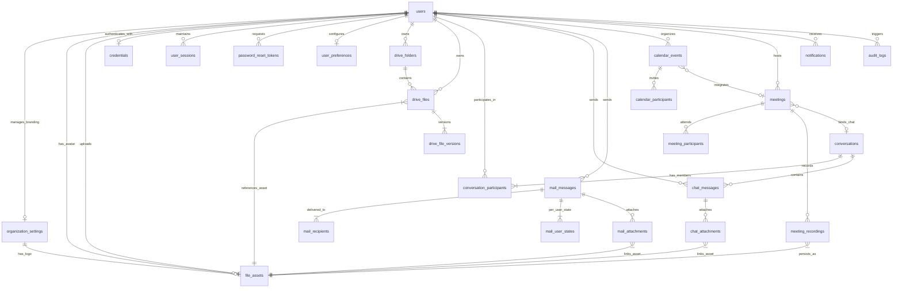
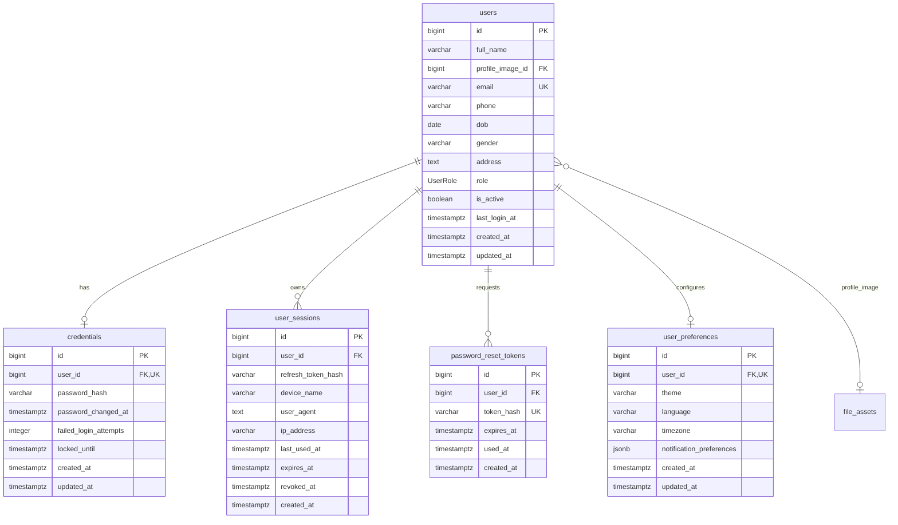
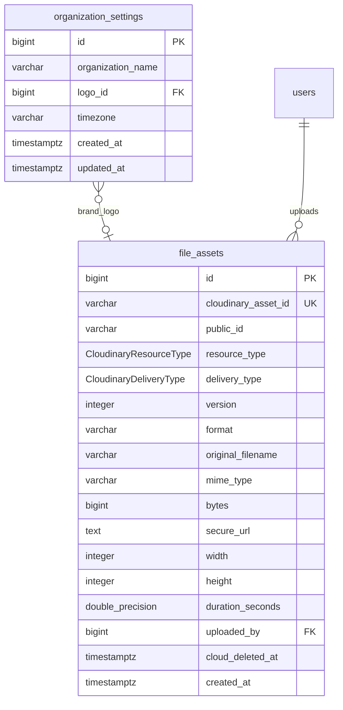
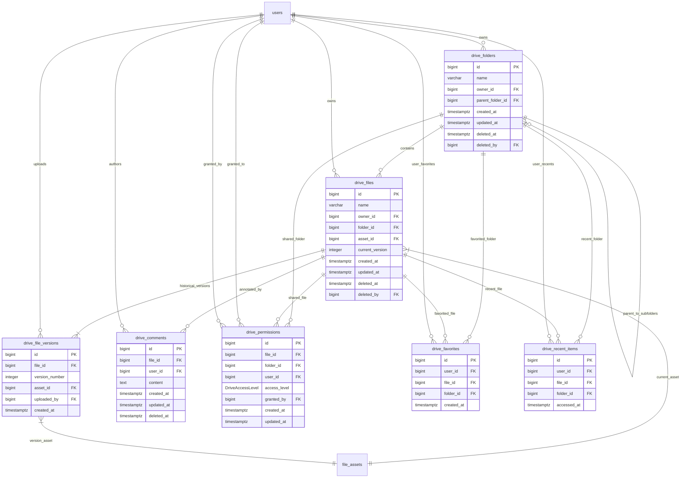
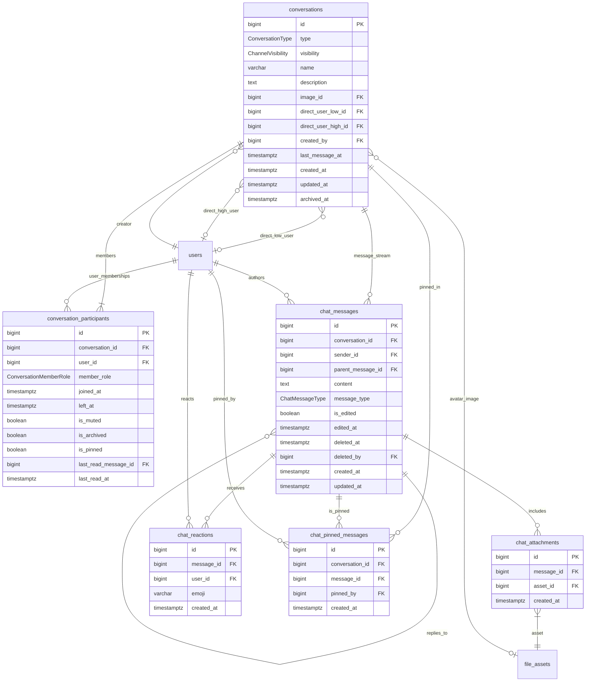
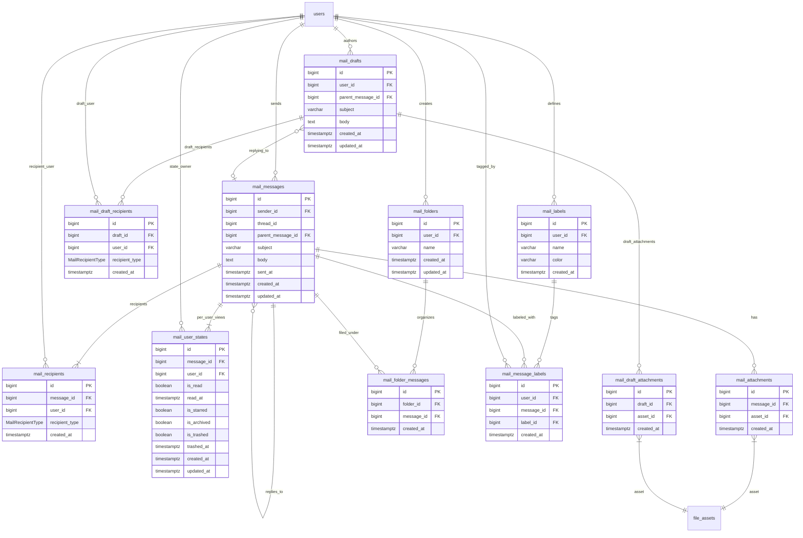
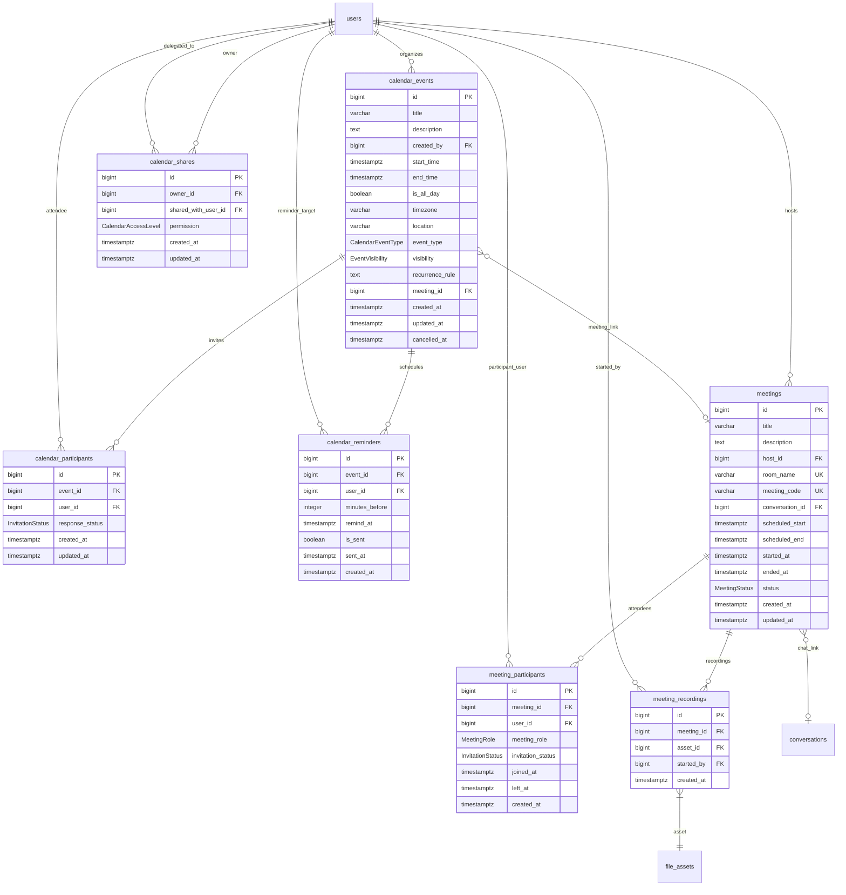
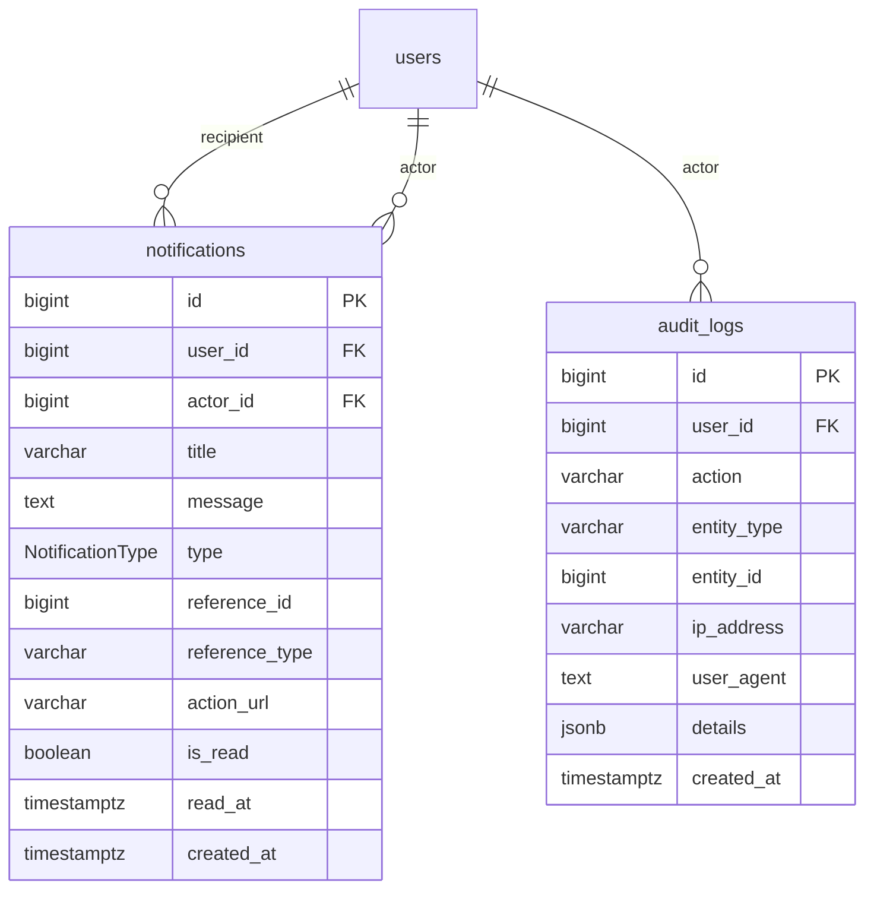

# Orvexa Platform — Entity-Relationship Diagram (ERD) Specification

## Document Control & Metadata

| Attribute | Specification |
| :--- | :--- |
| **Document Title** | Orvexa Enterprise Entity-Relationship Diagram (ERD) Specification |
| **Document Version** | `1.0.0` (Production Reference) |
| **Companion Specification** | [`database-design.md`](file:///workspace/Projects/Orvexa/docs/database/database-design.md) |
| **Target Engine** | PostgreSQL 16+ |
| **Diagramming Standard** | Crow's Foot Notation via Mermaid `erDiagram` |
| **Schema Reference** | `apps/api/prisma/schema/*.prisma` & `apps/api/prisma/migrations/` |
| **Total Entity Models** | 27 Physical Relational Tables |
| **Last Reviewed** | November 2026 |

---

## 1. Architectural Overview & Diagram Notation

This document provides visual topological models of the Orvexa enterprise database. The schema is anchored by two central hubs:
1. **`users`** — Central actor in the Identity, Authorization, Collaboration, Mail, Drive, Calendar, Meeting, and Audit domains.
2. **`file_assets`** — Central digital asset management (DAM) hub managing all physical media stored in Cloudinary.

### 1.1 Crow's Foot Cardinality Notation Reference

```
    ||--||    Exactly One to Exactly One
    ||--o|    Exactly One to Zero or One
    ||--|{    Exactly One to One or More
    ||--o{    Exactly One to Zero or More
```

---

## 2. High-Level Core Platform Architecture ERD

This high-level ERD illustrates the foundational inter-subsystem connections between primary domain anchors across the Orvexa platform.



---

## 3. Subsystem Domain Deep-Dive ERDs

---

### 3.1 Identity & Access Management (IAM) Domain

Stores user identities, credentials, active sessions, password reset tokens, and localized preferences.



---

### 3.2 Organization Settings & Media Storage (DAM) Domain

Centralized asset registry abstracting Cloudinary cloud storage and workspace-level configuration.



---

### 3.3 Cloud Drive & Document Management Subsystem (DMS)

Hierarchical directories, versioned files, granular sharing permissions, comments, favorites, and access logs.



---

### 3.4 Real-Time Chat, Channels & Messaging Subsystem

Supports 1-on-1 direct rooms, multi-user groups, and broadcast channels with rich message types, reactions, threaded replies, and pinned items.



---

### 3.5 Unified Mail Collaboration Subsystem

RFC 5322 email transmission with per-user decoupled state (read/star/archive/trash), custom folder trees, color labels, and draft autosaving.



---

### 3.6 Calendar & Video Meetings Subsystem

Event scheduling, attendee RSVPs, cron reminders, calendar sharing, and LiveKit WebRTC meetings with recordings.



---

### 3.7 Notifications & Activity Audit Trail Subsystem

Central notification inbox with polymorphic referencing, and an append-only compliance audit trail.



---

## 4. Comprehensive Foreign Key & Cardinality Reference Matrix

The following matrix documents all 50+ foreign key constraints in the Orvexa database, detailing relationship cardinality, source/target tables, and PostgreSQL referential delete actions.

| # | Source Table | Foreign Key Column | Target Table | Target Column | Cardinality | ON DELETE Action | Business Meaning / Dependency |
| :- | :--- | :--- | :--- | :--- | :--- | :--- | :--- |
| **1** | `organization_settings` | `logo_id` | `file_assets` | `id` | `N:0..1` | `SET NULL` | Organization branding logo image. |
| **2** | `users` | `profile_image_id` | `file_assets` | `id` | `N:0..1` | `SET NULL` | User avatar image. |
| **3** | `credentials` | `user_id` | `users` | `id` | `1:1` | `CASCADE` | User authentication secret credentials. |
| **4** | `user_sessions` | `user_id` | `users` | `id` | `N:1` | `CASCADE` | User client login session tokens. |
| **5** | `password_reset_tokens`| `user_id` | `users` | `id` | `N:1` | `CASCADE` | Ephemeral reset verification tokens. |
| **6** | `user_preferences` | `user_id` | `users` | `id` | `1:1` | `CASCADE` | UI and notification settings per user. |
| **7** | `file_assets` | `uploaded_by` | `users` | `id` | `N:0..1` | `SET NULL` | User who uploaded the physical asset. |
| **8** | `drive_folders` | `owner_id` | `users` | `id` | `N:1` | `RESTRICT` | Prevent deleting users owning active folders. |
| **9** | `drive_folders` | `parent_folder_id` | `drive_folders` | `id` | `N:0..1` | `RESTRICT` | Self-referencing directory tree hierarchy. |
| **10**| `drive_folders` | `deleted_by` | `users` | `id` | `N:0..1` | `SET NULL` | User who soft-deleted the directory. |
| **11**| `drive_files` | `owner_id` | `users` | `id` | `N:1` | `RESTRICT` | Prevent deleting users owning active files. |
| **12**| `drive_files` | `folder_id` | `drive_folders` | `id` | `N:0..1` | `RESTRICT` | Parent folder containment (`NULL` = root). |
| **13**| `drive_files` | `asset_id` | `file_assets` | `id` | `N:1` | `RESTRICT` | Current active file asset head pointer. |
| **14**| `drive_files` | `deleted_by` | `users` | `id` | `N:0..1` | `SET NULL` | User who soft-deleted the file. |
| **15**| `drive_file_versions` | `file_id` | `drive_files` | `id` | `N:1` | `CASCADE` | Historical file revision log. |
| **16**| `drive_file_versions` | `asset_id` | `file_assets` | `id` | `N:1` | `RESTRICT` | Immutable binary asset for this version. |
| **17**| `drive_file_versions` | `uploaded_by` | `users` | `id` | `N:1` | `RESTRICT` | User who submitted the revision. |
| **18**| `drive_permissions` | `file_id` | `drive_files` | `id` | `N:0..1` | `CASCADE` | XOR file permission target. |
| **19**| `drive_permissions` | `folder_id` | `drive_folders` | `id` | `N:0..1` | `CASCADE` | XOR folder permission target. |
| **20**| `drive_permissions` | `user_id` | `users` | `id` | `N:1` | `CASCADE` | Granted recipient user. |
| **21**| `drive_permissions` | `granted_by` | `users` | `id` | `N:1` | `RESTRICT` | Authorizing manager user. |
| **22**| `drive_favorites` | `file_id` | `drive_files` | `id` | `N:0..1` | `CASCADE` | XOR favorited file target. |
| **23**| `drive_favorites` | `folder_id` | `drive_folders` | `id` | `N:0..1` | `CASCADE` | XOR favorited folder target. |
| **24**| `drive_favorites` | `user_id` | `users` | `id` | `N:1` | `CASCADE` | User who favorited the item. |
| **25**| `drive_recent_items` | `file_id` | `drive_files` | `id` | `N:0..1` | `CASCADE` | XOR recent file target. |
| **26**| `drive_recent_items` | `folder_id` | `drive_folders` | `id` | `N:0..1` | `CASCADE` | XOR recent folder target. |
| **27**| `drive_recent_items` | `user_id` | `users` | `id` | `N:1` | `CASCADE` | User who accessed the item. |
| **28**| `drive_comments` | `file_id` | `drive_files` | `id` | `N:1` | `CASCADE` | File annotation conversation thread. |
| **29**| `drive_comments` | `user_id` | `users` | `id` | `N:1` | `RESTRICT` | Author of the comment. |
| **30**| `conversations` | `image_id` | `file_assets` | `id` | `N:0..1` | `SET NULL` | Conversation/channel avatar graphic. |
| **31**| `conversations` | `direct_user_low_id` | `users` | `id` | `N:0..1` | `SET NULL` | Canonical low user ID for 1-on-1 direct rooms. |
| **32**| `conversations` | `direct_user_high_id`| `users` | `id` | `N:0..1` | `SET NULL` | Canonical high user ID for 1-on-1 direct rooms. |
| **33**| `conversations` | `created_by` | `users` | `id` | `N:1` | `RESTRICT` | Room initiator / owner. |
| **34**| `conversation_participants`| `conversation_id`| `conversations` | `id` | `N:1` | `CASCADE` | Room membership mapping. |
| **35**| `conversation_participants`| `user_id` | `users` | `id` | `N:1` | `CASCADE` | Participating member user. |
| **36**| `conversation_participants`| `last_read_message_id`| `chat_messages`| `id`| `N:0..1`| `SET NULL` | Watermark cursor for unread counters. |
| **37**| `chat_messages` | `conversation_id` | `conversations` | `id` | `N:1` | `CASCADE` | Messages in room stream. |
| **38**| `chat_messages` | `sender_id` | `users` | `id` | `N:1` | `RESTRICT` | Author of the message. |
| **39**| `chat_messages` | `parent_message_id` | `chat_messages` | `id` | `N:0..1` | `SET NULL` | Threaded reply parent pointer. |
| **40**| `chat_messages` | `deleted_by` | `users` | `id` | `N:0..1` | `SET NULL` | User who soft-deleted the message. |
| **41**| `chat_attachments` | `message_id` | `chat_messages` | `id` | `N:1` | `CASCADE` | Message attachments. |
| **42**| `chat_attachments` | `asset_id` | `file_assets` | `id` | `N:1` | `RESTRICT` | Attached physical media asset. |
| **43**| `chat_reactions` | `message_id` | `chat_messages` | `id` | `N:1` | `CASCADE` | Emoji reaction targets. |
| **44**| `chat_reactions` | `user_id` | `users` | `id` | `N:1` | `CASCADE` | User who reacted. |
| **45**| `chat_pinned_messages`| `conversation_id`| `conversations` | `id` | `N:1` | `CASCADE` | Room pinned list. |
| **46**| `chat_pinned_messages`| `message_id` | `chat_messages` | `id` | `N:1` | `CASCADE` | Target pinned message. |
| **47**| `chat_pinned_messages`| `pinned_by` | `users` | `id` | `N:1` | `RESTRICT` | Moderator who pinned the message. |
| **48**| `mail_messages` | `sender_id` | `users` | `id` | `N:1` | `RESTRICT` | Author of the sent email. |
| **49**| `mail_messages` | `parent_message_id` | `mail_messages` | `id` | `N:0..1` | `SET NULL` | Email reply chain thread parent. |
| **50**| `mail_recipients` | `message_id` | `mail_messages` | `id` | `N:1` | `CASCADE` | Delivery routing list. |
| **51**| `mail_recipients` | `user_id` | `users` | `id` | `N:1` | `CASCADE` | Recipient user ID. |
| **52**| `mail_user_states` | `message_id` | `mail_messages` | `id` | `N:1` | `CASCADE` | Per-user decoupled state (read/star/trash). |
| **53**| `mail_user_states` | `user_id` | `users` | `id` | `N:1` | `CASCADE` | State owner. |
| **54**| `mail_attachments` | `message_id` | `mail_messages` | `id` | `N:1` | `CASCADE` | Email attachment list. |
| **55**| `mail_attachments` | `asset_id` | `file_assets` | `id` | `N:1` | `RESTRICT` | Attachment physical media asset. |
| **56**| `mail_drafts` | `user_id` | `users` | `id` | `N:1` | `CASCADE` | Draft author. |
| **57**| `mail_drafts` | `parent_message_id` | `mail_messages` | `id` | `N:0..1` | `SET NULL` | Email being replied to in draft. |
| **58**| `mail_draft_recipients`| `draft_id` | `mail_drafts` | `id` | `N:1` | `CASCADE` | Draft recipient staging. |
| **59**| `mail_draft_recipients`| `user_id` | `users` | `id` | `N:1` | `CASCADE` | Staged recipient user. |
| **60**| `mail_draft_attachments`| `draft_id` | `mail_drafts` | `id` | `N:1` | `CASCADE` | Staged draft attachments. |
| **61**| `mail_draft_attachments`| `asset_id` | `file_assets` | `id` | `N:1` | `RESTRICT` | Staged media asset. |
| **62**| `mail_folders` | `user_id` | `users` | `id` | `N:1` | `CASCADE` | Custom user folder tree. |
| **63**| `mail_folder_messages`| `folder_id` | `mail_folders` | `id` | `N:1` | `CASCADE` | Folder containment mapping. |
| **64**| `mail_folder_messages`| `message_id` | `mail_messages` | `id` | `N:1` | `CASCADE` | Message inside folder. |
| **65**| `mail_labels` | `user_id` | `users` | `id` | `N:1` | `CASCADE` | Custom user label tags. |
| **66**| `mail_message_labels` | `user_id` | `users` | `id` | `N:1` | `CASCADE` | Label assignment owner. |
| **67**| `mail_message_labels` | `message_id` | `mail_messages` | `id` | `N:1` | `CASCADE` | Labeled email message. |
| **68**| `mail_message_labels` | `label_id` | `mail_labels` | `id` | `N:1` | `CASCADE` | Assigned label tag. |
| **69**| `calendar_events` | `created_by` | `users` | `id` | `N:1` | `RESTRICT` | Event creator / organizer. |
| **70**| `calendar_events` | `meeting_id` | `meetings` | `id` | `N:0..1` | `SET NULL` | Cross-linked WebRTC meeting room. |
| **71**| `calendar_participants`| `event_id` | `calendar_events` | `id` | `N:1` | `CASCADE` | Event invitees / attendees. |
| **72**| `calendar_participants`| `user_id` | `users` | `id` | `N:1` | `CASCADE` | Invitee user. |
| **73**| `calendar_reminders` | `event_id` | `calendar_events` | `id` | `N:1` | `CASCADE` | Scheduled event alert queue. |
| **74**| `calendar_reminders` | `user_id` | `users` | `id` | `N:1` | `CASCADE` | Alert recipient user. |
| **75**| `calendar_shares` | `owner_id` | `users` | `id` | `N:1` | `CASCADE` | Delegating calendar owner. |
| **76**| `calendar_shares` | `shared_with_user_id`| `users` | `id` | `N:1` | `CASCADE` | Authorized recipient user. |
| **77**| `meetings` | `host_id` | `users` | `id` | `N:1` | `RESTRICT` | LiveKit meeting host. |
| **78**| `meetings` | `conversation_id` | `conversations` | `id` | `N:0..1` | `SET NULL` | Persistent meeting chat room. |
| **79**| `meeting_participants`| `meeting_id` | `meetings` | `id` | `N:1` | `CASCADE` | Meeting attendees & RSVP tracking. |
| **80**| `meeting_participants`| `user_id` | `users` | `id` | `N:1` | `CASCADE` | Attendee user. |
| **81**| `meeting_recordings` | `meeting_id` | `meetings` | `id` | `N:1` | `CASCADE` | Conference recordings. |
| **82**| `meeting_recordings` | `asset_id` | `file_assets` | `id` | `N:1` | `RESTRICT` | Physical video/audio media asset. |
| **83**| `meeting_recordings` | `started_by` | `users` | `id` | `N:0..1` | `SET NULL` | User who initiated recording. |
| **84**| `notifications` | `user_id` | `users` | `id` | `N:1` | `CASCADE` | Notification recipient. |
| **85**| `notifications` | `actor_id` | `users` | `id` | `N:0..1` | `SET NULL` | Triggering actor user. |
| **86**| `audit_logs` | `user_id` | `users` | `id` | `N:0..1` | `SET NULL` | Acting user (`NULL` = system task). |

---

## 5. Topological Notes & Special Constraint Structures

### 5.1 Self-Referencing Recursive Trees
Three distinct models in Orvexa utilize hierarchical self-referencing relationships:
1. **`drive_folders`:** `parent_folder_id` references `drive_folders.id` with `ON DELETE RESTRICT`, preventing accidental recursive subtree deletion without explicit client confirmation.
2. **`chat_messages`:** `parent_message_id` references `chat_messages.id` with `ON DELETE SET NULL`, preserving conversational context while decoupling reply chains.
3. **`mail_messages`:** `parent_message_id` references `mail_messages.id` with `ON DELETE SET NULL`, maintaining threaded email conversation grouping.

### 5.2 Exclusive Arc (XOR) Polymorphic Patterns
For `drive_permissions`, `drive_favorites`, and `drive_recent_items`:
- A database check constraint enforces that exactly one of `file_id` or `folder_id` is non-null:
  $$\left(\text{file\_id} \text{ IS NOT NULL} \land \text{folder\_id} \text{ IS NULL}\right) \lor \left(\text{file\_id} \text{ IS NULL} \land \text{folder\_id} \text{ IS NOT NULL}\right)$$
- Partial unique indexes enforce idempotency per user per target node without resorting to unconstrained polymorphic string columns.

### 5.3 Canonical Direct Message Pair Constraint
In `conversations`:
- For 1-on-1 direct rooms (`type = 'DIRECT'`), `direct_user_low_id < direct_user_high_id` is strictly enforced by check constraint.
- The composite unique index on `("direct_user_low_id", "direct_user_high_id")` guarantees that only one direct room can ever exist between any two users in the workspace.
